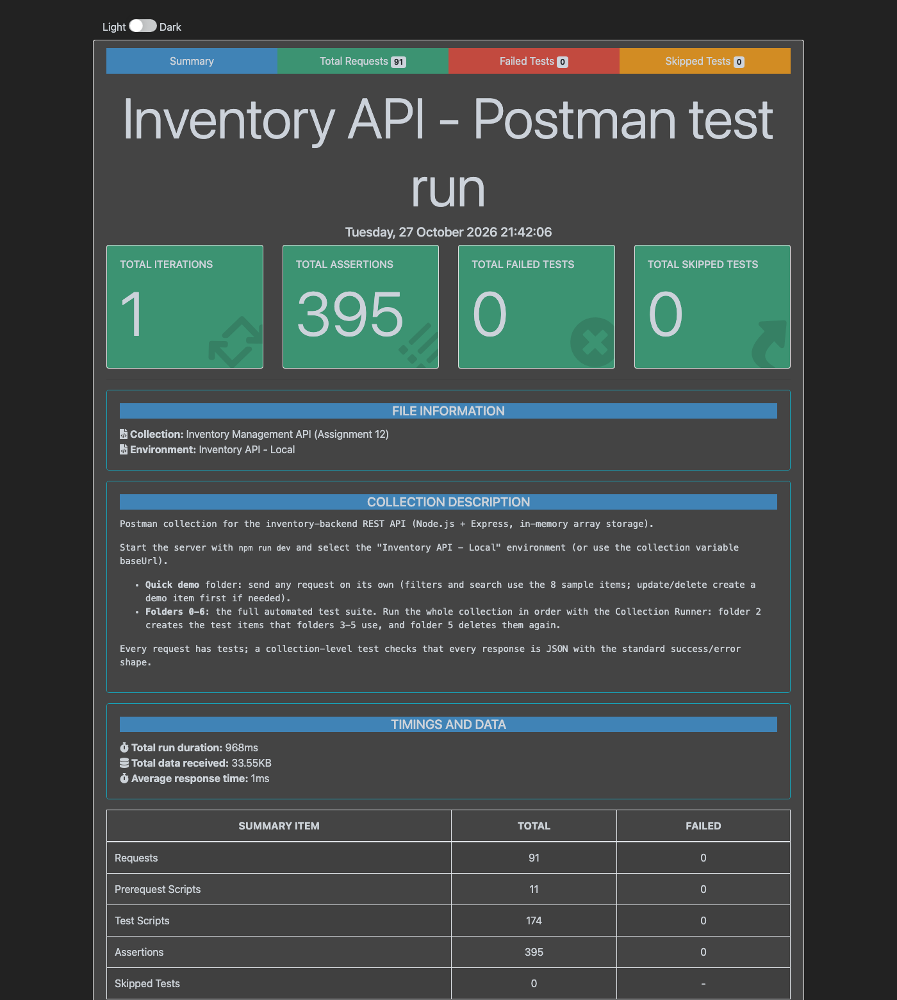

# Inventory Backend – Simple Inventory Management System

A backend-only REST API for managing inventory items, built with **Node.js + Express** for
*Full Stack Development V8 – Assignment 12*.

All data is kept in an **in-memory array** (`let inventory = []`). There is no database and nothing
is written to files, so the data resets to the sample items every time the server restarts.

**GitHub repository:** https://github.com/fathimakh/inventory-backend

---

## Table of contents

- [Features](#features)
- [Tech stack](#tech-stack)
- [Folder structure](#folder-structure)
- [Getting started](#getting-started)
- [Environment variables](#environment-variables)
- [Data model](#data-model)
- [API reference](#api-reference)
- [Query parameters (filter, search, sort, paginate)](#query-parameters-filter-search-sort-paginate)
- [Error handling](#error-handling)
- [How a request flows through the app](#how-a-request-flows-through-the-app)
- [Testing with Postman / Thunder Client](#testing-with-postman--thunder-client)

---

## Features

- **Inventory CRUD**: add, update (full `PUT` or partial `PATCH`), delete, fetch one item and fetch all items
- **Stock adjustment**: increase or decrease stock with `PATCH /api/inventory/:id/stock`. Stock can never go below 0
- **Filtering** by category, exact quantity, quantity range (`minQty` / `maxQty`) and stock status (`inStock`)
- **Searching** by item name: partial and case-insensitive, on the list endpoint (`?name=`) or the dedicated `/search` endpoint
- **Sorting and pagination** (`sortBy`, `order`, `page`, `limit`)
- **Array-based data store**: `push`, update by index, `splice` delete. Every write is checked first (item exists, unique name, stock limits)
- **Request validation middleware** for route params, request bodies and query strings. All problems are reported together in one response
- **Centralized error handler**: every error, including unknown routes, malformed JSON and wrong HTTP methods, returns the same JSON shape with the correct status code
- **Environment variables** through `dotenv`, plus **CORS** support
- **Postman collection** with a click-through demo folder plus a full automated test suite (87 requests, 395 assertions)

## Tech stack

| Purpose | Package |
| --- | --- |
| Runtime | Node.js (v18 or newer) |
| Web framework | [Express 5](https://expressjs.com/) |
| Environment variables | [dotenv](https://www.npmjs.com/package/dotenv) |
| Cross-origin requests | [cors](https://www.npmjs.com/package/cors) |
| Auto-restart in development | [nodemon](https://www.npmjs.com/package/nodemon) (dev dependency) |
| API testing | Postman / Thunder Client, [newman](https://www.npmjs.com/package/newman) (Postman CLI) |

## Folder structure

```
inventory-backend/
├── index.js                          # Main entry point for the Express server
├── controllers/
│   ├── inventoryController.js        # Handles CRUD and querying logic
│   └── infoController.js             # API info (GET /) and health check
├── routes/
│   ├── inventoryRoutes.js            # Inventory API endpoints
│   └── infoRoutes.js                 # GET / and GET /api/health
├── middleware/
│   ├── validation.js                 # Input validation middleware
│   └── errorHandler.js               # Centralized error middleware
├── model/
│   └── inventoryData.js              # Array-based in-memory model
├── postman/
│   ├── Inventory-API.postman_collection.json   # Requests + automated tests
│   └── Inventory-API.postman_environment.json  # baseUrl = http://localhost:5012
├── docs/
│   ├── newman-report.html            # HTML report of the last full test run
│   ├── newman-run.txt                # Terminal output of the same run
│   └── newman-summary.png            # Screenshot of the report summary
├── .env                              # Environment variables (local only, git-ignored)
├── .env.example                      # Template for .env (committed)
├── .gitignore                        # Git ignore file
├── package.json
└── README.md
```

| Layer | File | What it does |
| --- | --- | --- |
| Entry point | `index.js` | Only bootstraps the app: loads `.env`, registers global middleware (logger, CORS, JSON parser), mounts the routers, then the 404 and error handlers, and starts the server |
| Routes | `routes/inventoryRoutes.js` | Maps each inventory URL + HTTP method to its validation middleware and controller. Unsupported methods get a 405 |
| Routes | `routes/infoRoutes.js` | `GET /` (API info) and `GET /api/health` |
| Controller | `controllers/inventoryController.js` | Business rules (does the item exist? is the name unique? is there enough stock?), filtering, sorting and pagination, and the success responses |
| Controller | `controllers/infoController.js` | Builds the API info and health check responses |
| Validation | `middleware/validation.js` | Checks the `:id` param, request bodies and query strings before they reach the controller |
| Error handling | `middleware/errorHandler.js` | `AppError` class, 404 and 405 handlers, and the centralized error handler that formats every error |
| Model | `model/inventoryData.js` | The `inventory` array and the only functions that read or change it |

## Getting started

### Prerequisites

- [Node.js](https://nodejs.org/) 18 or newer (includes npm)

### How the project was set up

These are the setup steps from the assignment brief:

```bash
mkdir inventory-backend
cd inventory-backend
npm init -y
npm i express dotenv cors      # core dependencies
npm i -D nodemon               # restarts the server on file changes
```

### Run it locally

```bash
# 1. Clone the repository and enter the folder
git clone https://github.com/fathimakh/inventory-backend.git
cd inventory-backend

# 2. Install dependencies
npm install

# 3. Create your .env file from the template
cp .env.example .env           # Windows (cmd): copy .env.example .env

# 4. Start the development server (auto-restarts with nodemon)
npm run dev
```

The server prints:

```
Inventory API running at http://localhost:5012 (development)
```

Open <http://localhost:5012> to see the list of endpoints, or <http://localhost:5012/api/health> for a health check.

> `.env` is optional: without it the server uses the defaults below (port 5012, development mode, sample data on).
> Use `npm start` to run without nodemon.

## Environment variables

Defined in `.env` (copy it from `.env.example`):

| Variable | Default | Description |
| --- | --- | --- |
| `PORT` | `5012` | Port the server listens on |
| `NODE_ENV` | `development` | `development` logs each request and includes stack traces in 500 responses. `production` hides them |
| `SEED_DATA` | `true` | Load 8 sample items into the array on startup. Set to `false` to start with an empty inventory |
| `CORS_ORIGIN` | `*` | Allowed origin(s) for browser clients: `*` or a comma-separated list such as `http://localhost:5173,http://localhost:3000` |

`.env` is listed in `.gitignore`, following the usual practice of never committing environment files.
This project has no secrets, so `.env.example` contains the exact same values.

## Data model

Every item in the `inventory` array has this shape:

```json
{
  "id": 1,
  "name": "Wireless Mouse",
  "category": "Electronics",
  "quantity": 45,
  "price": 799,
  "supplier": "Logitech",
  "createdAt": "2026-10-27T15:37:37.013Z",
  "updatedAt": "2026-10-27T15:37:37.013Z"
}
```

| Field | Type | Rules |
| --- | --- | --- |
| `id` | number | Set by the server (auto-increment). Never reused, even after a delete. Read-only |
| `name` | string | **Required.** 2–100 characters, **unique** (case-insensitive, ignoring extra and invisible spaces) |
| `category` | string | **Required.** 2–50 characters |
| `quantity` | integer | **Required.** Whole number from 0 to 1,000,000 |
| `price` | number | **Required.** 0 to 10,000,000, at most 2 decimal places |
| `supplier` | string \| null | Optional. 2–100 characters. `null` or `""` clears it |
| `createdAt` / `updatedAt` | ISO date string | Set by the server. Read-only |

Text fields are trimmed, repeated spaces are collapsed and invisible characters (zero-width spaces, soft hyphens,
direction marks, ...) are removed, so `"  Desk   Lamp "` is stored as `"Desk Lamp"`. Text must contain at least one
letter or number, and text containing control characters such as tabs or line breaks is rejected.
Read-only fields (`id`, `createdAt`, `updatedAt`) are ignored if you send them, so a body copied from a `GET`
response can be sent straight back with `PUT`. Any other unknown field (a typo like `"quantiy"`) is rejected with a 400.

### How the array is handled (`model/inventoryData.js`)

| Operation | Array logic | Checks |
| --- | --- | --- |
| Create | `inventory.push(item)` with `id: nextId++` | Validation middleware first. The controller rejects duplicate names (409) using `findByName`, which compares tidied, lower-cased names |
| Read | `inventory.find(...)` / `inventory.map(...)` | Returns **copies**, so callers cannot change the array by accident. `null` when the id doesn't exist (404) |
| Replace / update | `findIndex`, then a new object is written to `inventory[index]` | Item must exist (404), new name must be unique (409). `id` and `createdAt` can never change. `updatedAt` is refreshed |
| Stock adjustment | update of `quantity` | The result must stay between 0 and 1,000,000 (409 otherwise) |
| Delete | `findIndex`, then `inventory.splice(index, 1)` | Item must exist (404). The deleted item is returned |

Eight sample items (Electronics, Furniture, Stationery) are loaded on startup so the API can be tried right away.

## API reference

**Base URL:** `http://localhost:5012`

### Response format

Every response is JSON with a `success` flag.

```jsonc
// Success
{ "success": true, "message": "...", "data": { ... } }

// Success: list endpoints also return count, total, the applied filters and sort (and pagination when used)
{ "success": true, "message": "...", "count": 2, "total": 2, "filters": {}, "sort": {}, "data": [ ... ] }

// Error: always the same shape (see "Error handling")
{ "success": false, "error": { "statusCode": 404, "code": "ITEM_NOT_FOUND", "message": "...", "details": [ ... ] } }
```

### Endpoints

| Method | Endpoint | Description | Success |
| --- | --- | --- | --- |
| `GET` | `/` | API info: endpoints and query parameters | 200 |
| `GET` | `/api/health` | Health check (status, uptime, number of items in memory) | 200 |
| `GET` | `/api/inventory` | Fetch all items. Supports [filter / search / sort / paginate](#query-parameters-filter-search-sort-paginate) | 200 |
| `GET` | `/api/inventory/search?name=` | Search items by name (accepts the same filters) | 200 |
| `GET` | `/api/inventory/:id` | Fetch a single item | 200 |
| `POST` | `/api/inventory` | Add a new item | 201 |
| `PUT` | `/api/inventory/:id` | Replace an item (all required fields) | 200 |
| `PATCH` | `/api/inventory/:id` | Update only the fields you send | 200 |
| `PATCH` | `/api/inventory/:id/stock` | Increase or decrease the stock by `adjustment` | 200 |
| `DELETE` | `/api/inventory/:id` | Delete an item | 200 |

`:id` must be a positive whole number (`/api/inventory/abc` returns `400 INVALID_ID`).
Requests with a body must send `Content-Type: application/json`.

---

#### Fetch all items

```http
GET /api/inventory?category=furniture
```

```json
{
  "success": true,
  "message": "2 item(s) found",
  "count": 2,
  "total": 2,
  "filters": { "category": "furniture" },
  "sort": { "sortBy": "id", "order": "asc" },
  "data": [
    { "id": 4, "name": "Office Chair", "category": "Furniture", "quantity": 8, "price": 7499, "supplier": "Green Soul", "createdAt": "2026-10-27T15:37:37.014Z", "updatedAt": "2026-10-27T15:37:37.014Z" },
    { "id": 5, "name": "Standing Desk", "category": "Furniture", "quantity": 3, "price": 18999, "supplier": "Featherlite", "createdAt": "2026-10-27T15:37:37.014Z", "updatedAt": "2026-10-27T15:37:37.014Z" }
  ]
}
```

`count` is the number of items in this response and `total` is the number of items that matched (they differ only when paginating).

#### Fetch a single item

```http
GET /api/inventory/1
```

```json
{
  "success": true,
  "data": { "id": 1, "name": "Wireless Mouse", "category": "Electronics", "quantity": 45, "price": 799, "supplier": "Logitech", "createdAt": "2026-10-27T15:37:37.013Z", "updatedAt": "2026-10-27T15:37:37.013Z" }
}
```

A missing id returns `404`:

```json
{ "success": false, "error": { "statusCode": 404, "code": "ITEM_NOT_FOUND", "message": "Item with id 999 not found" } }
```

#### Add an item

```http
POST /api/inventory
Content-Type: application/json

{
  "name": "Desk Lamp",
  "category": "Lighting",
  "quantity": 20,
  "price": 1299.5,
  "supplier": "Philips"
}
```

Response `201 Created` (with a `Location: /api/inventory/9` header):

```json
{
  "success": true,
  "message": "Item created successfully",
  "data": { "id": 9, "name": "Desk Lamp", "category": "Lighting", "quantity": 20, "price": 1299.5, "supplier": "Philips", "createdAt": "2026-10-27T15:37:37.335Z", "updatedAt": "2026-10-27T15:37:37.335Z" }
}
```

#### Replace an item (PUT)

`PUT` replaces the whole item, so `name`, `category`, `quantity` and `price` are all required.
An optional field you leave out (`supplier`) is cleared.

```http
PUT /api/inventory/9
Content-Type: application/json

{ "name": "LED Desk Lamp", "category": "Lighting", "quantity": 25, "price": 1499, "supplier": "Philips" }
```

```json
{
  "success": true,
  "message": "Item replaced successfully",
  "data": { "id": 9, "name": "LED Desk Lamp", "category": "Lighting", "quantity": 25, "price": 1499, "supplier": "Philips", "createdAt": "2026-10-27T15:37:37.335Z", "updatedAt": "2026-10-27T15:37:37.368Z" }
}
```

#### Update some fields (PATCH)

```http
PATCH /api/inventory/9
Content-Type: application/json

{ "price": 1399 }
```

```json
{
  "success": true,
  "message": "Item updated successfully",
  "data": { "id": 9, "name": "LED Desk Lamp", "category": "Lighting", "quantity": 25, "price": 1399, "supplier": "Philips", "createdAt": "2026-10-27T15:37:37.335Z", "updatedAt": "2026-10-27T15:37:37.406Z" }
}
```

#### Adjust stock

Positive `adjustment` adds stock (restock). Negative removes stock (sale).

```http
PATCH /api/inventory/9/stock
Content-Type: application/json

{ "adjustment": -5 }
```

```json
{
  "success": true,
  "message": "Stock decreased by 5 (25 -> 20)",
  "data": { "id": 9, "name": "LED Desk Lamp", "category": "Lighting", "quantity": 20, "price": 1399, "supplier": "Philips", "createdAt": "2026-10-27T15:37:37.335Z", "updatedAt": "2026-10-27T15:37:37.442Z" }
}
```

Removing more than is in stock returns `409 INSUFFICIENT_STOCK`. Going above 1,000,000 returns `409 STOCK_LIMIT_EXCEEDED`.

#### Delete an item

```http
DELETE /api/inventory/9
```

```json
{
  "success": true,
  "message": "Item deleted successfully",
  "data": { "id": 9, "name": "LED Desk Lamp", "category": "Lighting", "quantity": 20, "price": 1399, "supplier": "Philips", "createdAt": "2026-10-27T15:37:37.335Z", "updatedAt": "2026-10-27T15:37:37.442Z" }
}
```

Deleting the same id again returns `404 ITEM_NOT_FOUND`.

## Query parameters (filter, search, sort, paginate)

`GET /api/inventory` and `GET /api/inventory/search` accept these query parameters. They can be combined freely.

| Parameter | Example | Meaning |
| --- | --- | --- |
| `name` | `?name=mouse` | **Search by item name**: partial, case-insensitive match. `search` is an alias (`?search=mouse`) |
| `category` | `?category=electronics` | Exact category, case-insensitive |
| `quantity` | `?quantity=0` | Exact quantity |
| `minQty` | `?minQty=10` | Quantity greater than or equal to `minQty` |
| `maxQty` | `?maxQty=50` | Quantity less than or equal to `maxQty` |
| `inStock` | `?inStock=true` | `true` = quantity > 0, `false` = out of stock (quantity 0) |
| `sortBy` | `?sortBy=price` | `id` (default), `name`, `category`, `quantity`, `price`, `createdAt`, `updatedAt` |
| `order` | `?order=desc` | `asc` (default) or `desc` |
| `page` | `?page=2` | Page number, starting at 1. Pagination is used only when `page` or `limit` is sent |
| `limit` | `?limit=5` | Items per page, 1–100. Defaults to 10 when only `page` is sent |

Examples:

| Request | Result |
| --- | --- |
| `GET /api/inventory?category=Electronics` | All electronics |
| `GET /api/inventory?minQty=5&maxQty=50` | Items with 5 to 50 units |
| `GET /api/inventory?quantity=0` | Items with exactly 0 units |
| `GET /api/inventory?inStock=false` | Out-of-stock items |
| `GET /api/inventory?name=desk` | Items whose name contains "desk" |
| `GET /api/inventory/search?name=desk` | Same search on the dedicated endpoint (`name` or `search` is required here) |
| `GET /api/inventory?category=stationery&inStock=true&sortBy=price&order=desc` | In-stock stationery, most expensive first |
| `GET /api/inventory?page=2&limit=3` | Items 4–6 |

The response echoes the applied filters, converted to their real types, so you can see exactly what was used:

```http
GET /api/inventory?minQty=5&maxQty=50&sortBy=quantity&order=desc
```

```json
{
  "success": true,
  "message": "4 item(s) found",
  "count": 4,
  "total": 4,
  "filters": { "minQty": 5, "maxQty": 50 },
  "sort": { "sortBy": "quantity", "order": "desc" },
  "data": [ "... Wireless Mouse (45), Mechanical Keyboard (12), Office Chair (8), Whiteboard Marker Set (5) ..." ]
}
```

With pagination, the response also has a `pagination` object:

```json
{
  "success": true,
  "message": "Showing 3 of 8 item(s) (page 2 of 3)",
  "count": 3,
  "total": 8,
  "filters": {},
  "sort": { "sortBy": "id", "order": "asc" },
  "pagination": { "page": 2, "limit": 3, "totalPages": 3, "hasNextPage": true, "hasPrevPage": true },
  "data": [ "... items 4, 5 and 6 ..." ]
}
```

Query parameter rules:

- No match is not an error: you get `200` with `"data": []` and `"total": 0`.
- Blank parameters (`?category=`) count as not sent.
- Text values are tidied like request bodies (trimmed, repeated spaces collapsed), so `?name=wireless%20%20mouse` finds "Wireless Mouse".
- A page past the end returns `200` with an empty `data` array and a message such as `Page 9 is out of range: 8 item(s) fit on 2 page(s)`.
- Invalid values, unknown parameter names (catches typos like `?catgory=`), repeated parameters and `minQty` greater than `maxQty` return `400` with every problem listed:

```json
{
  "success": false,
  "error": {
    "statusCode": 400,
    "code": "VALIDATION_ERROR",
    "message": "Invalid query parameters",
    "details": [
      { "field": "minQty", "message": "minQty must be a whole number between 0 and 1000000" },
      { "field": "colour", "message": "Unknown query parameter \"colour\". Allowed: name, search, category, quantity, minQty, maxQty, inStock, sortBy, order, page, limit" }
    ]
  }
}
```

## Error handling

All errors go through one centralized error handler (`middleware/errorHandler.js`) and use one shape:

```json
{
  "success": false,
  "error": {
    "statusCode": 400,
    "code": "VALIDATION_ERROR",
    "message": "Validation failed",
    "details": [
      { "field": "name", "message": "name cannot be empty" },
      { "field": "quantity", "message": "quantity must be between 0 and 1000000" },
      { "field": "price", "message": "price must be a number" }
    ]
  }
}
```

- `statusCode` always equals the HTTP status.
- `code` is a stable, machine-readable error code.
- `details` lists field-level problems. It is present only when there is something field-specific to report.

| Status | Code | When |
| --- | --- | --- |
| 400 | `VALIDATION_ERROR` | Missing or invalid body fields, unknown fields, a non-object body, or invalid query parameters |
| 400 | `INVALID_ID` | `:id` is not a positive whole number |
| 400 | `INVALID_JSON` | The request body is not valid JSON |
| 400 | `BAD_REQUEST` | Other malformed requests: a badly %-encoded URL, or a compressed body that cannot be decompressed |
| 404 | `ITEM_NOT_FOUND` | No item with that id |
| 404 | `ROUTE_NOT_FOUND` | The URL doesn't exist |
| 405 | `METHOD_NOT_ALLOWED` | The URL exists but not for this HTTP method (the `Allow` header lists the valid ones) |
| 409 | `DUPLICATE_ITEM` | Another item already has that name |
| 409 | `INSUFFICIENT_STOCK` | A stock adjustment would make the quantity negative |
| 409 | `STOCK_LIMIT_EXCEEDED` | A stock adjustment would go above 1,000,000 |
| 413 | `PAYLOAD_TOO_LARGE` | The body is larger than 10 KB |
| 415 | `UNSUPPORTED_MEDIA_TYPE` | A body was sent without `Content-Type: application/json`, or with a charset or `Content-Encoding` the server cannot read |
| 500 | `INTERNAL_SERVER_ERROR` | Unexpected server error. The details are logged on the server, and the stack trace is shown only when `NODE_ENV=development` |

## How a request flows through the app

```
Client (Postman)
   │
   ▼
index.js ── request logger → cors → express.json()
   │
   ▼
routes/inventoryRoutes.js ── picks the handler for the URL and method (405 if the method isn't supported)
   │                           (GET / and GET /api/health go through routes/infoRoutes.js → controllers/infoController.js)
   │
   ▼
middleware/validation.js ── validateId / validateItem / validateItemUpdate / validateListQuery ...
   │        (invalid input → next(AppError 400))
   ▼
controllers/inventoryController.js ── business rules (exists? unique? enough stock?) → next(AppError 404/409)
   │
   ▼
model/inventoryData.js ── reads or changes the `inventory` array
   │
   ▼
JSON response { success: true, ... }

Any error → middleware/errorHandler.js → JSON response { success: false, error: { ... } }
Unknown URL → notFound → 404 ROUTE_NOT_FOUND
```

## Testing with Postman / Thunder Client

The `postman/` folder contains a ready-made collection (87 requests, 395 automated assertions)
covering CRUD, filtering, searching, sorting, pagination and every error case. It has two parts:

| Folder | How to use it |
| --- | --- |
| **Quick demo (send any request on its own)** | Click any request and press **Send**. The filter and search requests use the 8 sample items. PUT, PATCH, stock and DELETE create a demo item first if there isn't one |
| **0. Health & Info** to **6. Errors** | The full automated test suite. Run it in order with the **Collection Runner**: folder 2 creates test items, folders 3–4 use them and folder 5 deletes them again, so the suite can be re-run on the same server |

### In Postman

1. Start the server with `npm run dev`.
2. In Postman, click **Import** and select both files in `postman/`:
   - `Inventory-API.postman_collection.json`
   - `Inventory-API.postman_environment.json`
3. Select the **Inventory API - Local** environment (top-right). It sets `baseUrl` to `http://localhost:5012`.
4. Open the **Quick demo** folder and send requests one by one, or run the whole collection with the **Collection Runner**.
   Every request has tests, which you can see in the **Test Results** tab.

Thunder Client (VS Code) can import the same collection: **Collections → Import → Postman collection**.

### From the command line (newman)

With the server running in another terminal:

```bash
npm run test:api
```

Result of the last full run on a freshly started server. The full output is in [`docs/newman-run.txt`](docs/newman-run.txt),
and an HTML report is in [`docs/newman-report.html`](docs/newman-report.html) (download it and open it in a browser).
The request count is higher than 87 because 4 Quick demo pre-request scripts first check whether the demo item exists.

```
┌─────────────────────────┬─────────────────┬─────────────────┐
│                         │        executed │          failed │
├─────────────────────────┼─────────────────┼─────────────────┤
│              iterations │               1 │               0 │
├─────────────────────────┼─────────────────┼─────────────────┤
│                requests │              91 │               0 │
├─────────────────────────┼─────────────────┼─────────────────┤
│            test-scripts │             174 │               0 │
├─────────────────────────┼─────────────────┼─────────────────┤
│      prerequest-scripts │              11 │               0 │
├─────────────────────────┼─────────────────┼─────────────────┤
│              assertions │             395 │               0 │
└─────────────────────────┴─────────────────┴─────────────────┘
```



### Quick checks with curl

```bash
curl http://localhost:5012/api/inventory
curl "http://localhost:5012/api/inventory?category=electronics&inStock=true"
curl "http://localhost:5012/api/inventory/search?name=desk"
curl -X POST http://localhost:5012/api/inventory \
  -H "Content-Type: application/json" \
  -d '{"name":"Desk Lamp","category":"Lighting","quantity":20,"price":1299.5}'
curl -X PATCH http://localhost:5012/api/inventory/1/stock \
  -H "Content-Type: application/json" -d '{"adjustment":-3}'
curl -X DELETE http://localhost:5012/api/inventory/1
```

---

> **Note:** the data lives only in memory. Restarting the server (including nodemon restarts after a file change)
> resets the inventory to the 8 sample items, or to an empty list when `SEED_DATA=false`.
